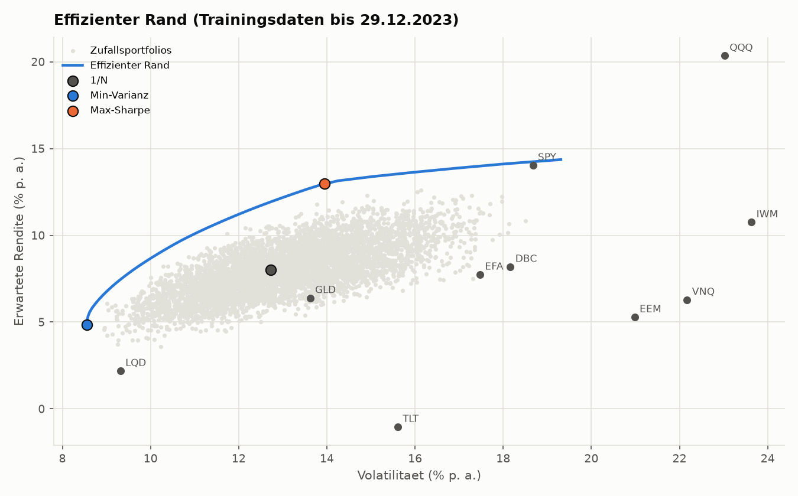
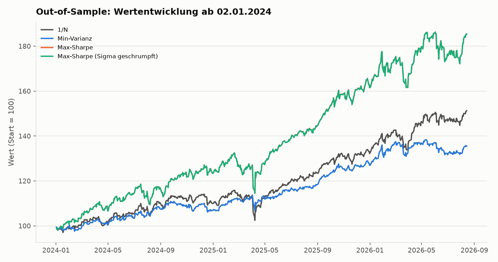
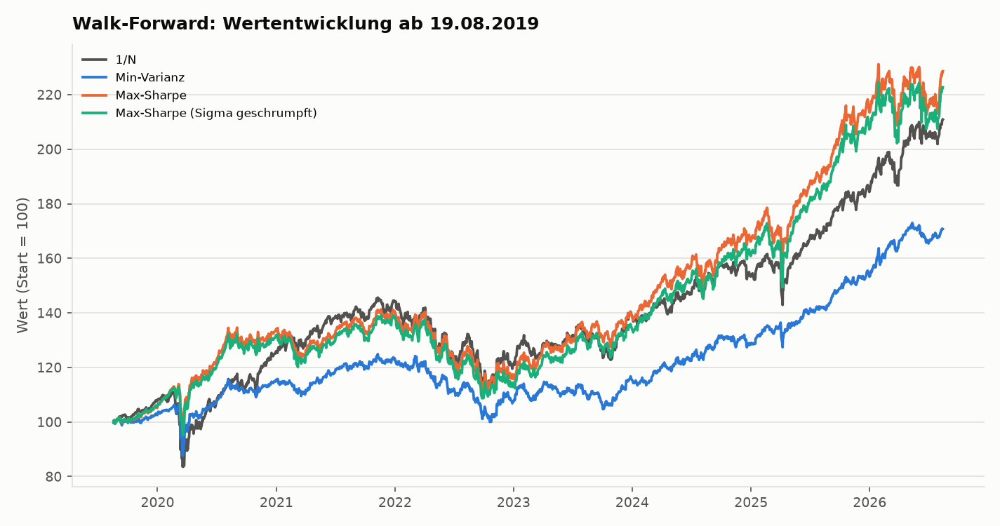
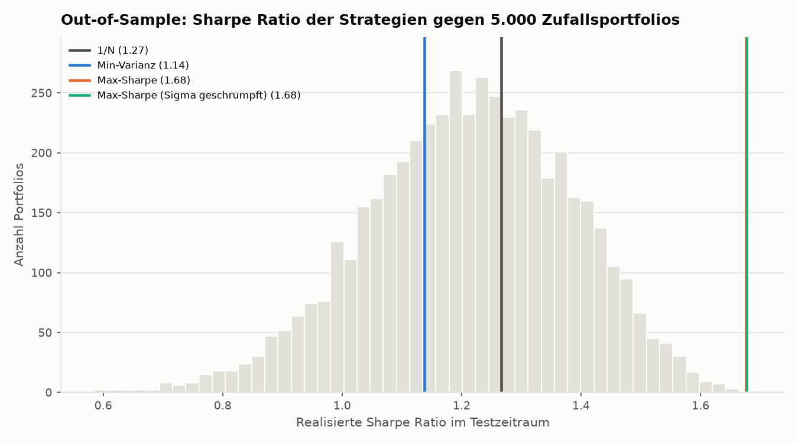

## Ergebnisse

Zeitraum: Training 16.08.2016 bis 29.12.2023 (1.856 Handelstage), Test 02.01.2024 bis 14.08.2026 (657 Handelstage). Gewichte höchstens 30 % je ETF, risikofreier Zins 3 %.

**Out-of-Sample (statischer Test):**

| Strategie | Rendite p. a. | Volatilität p. a. | Sharpe Ratio | Max. Drawdown |
|---|---|---|---|---|
| 1/N | 17,2 % | 11,2 % | 1,27 | −11,5 % |
| Min-Varianz | 12,4 % | 8,2 % | 1,14 | −6,0 % |
| Max-Sharpe | 26,7 % | 14,2 % | 1,68 | −13,5 % |
| Max-Sharpe (Sigma geschrumpft) | 26,7 % | 14,1 % | 1,68 | −13,5 % |

- **Statischer Test:** Max-Sharpe liegt vor 1/N und besser als 4.999 von 5.000 Zufallsportfolios mit derselben Gewichtsgrenze (Rang 0,9998). 1/N liegt auf Rang 0,61, Min-Varianz auf 0,32.
- **Erklärung:** Max-Sharpe war im Training auf QQQ, GLD und SPY konzentriert, die im Test zu den stärksten ETFs gehörten (GLD 32,9 %, QQQ 25,5 %, SPY 22,1 % p. a.). Min-Varianz hielt viel TLT und LQD, die im Test schwach waren (−2,9 % und 2,9 % p. a.).
- **Walk-Forward:** Max-Sharpe hat auch hier die höchste Sharpe Ratio (0,73 gegen 0,60 bei 1/N), der Vorsprung ist aber deutlich kleiner. Min-Varianz liegt mit 0,51 unter 1/N.
- **Schrumpfung:** Die Kovarianzschrumpfung (δ = 0,2) senkt die Kondition von 202 auf 43, verbessert das Ergebnis aber nicht (Walk-Forward: 0,69 gegen 0,73).
- **Training gegen Test:** Alle Strategien haben im Test eine höhere Sharpe Ratio als im Training. Der Abstand von Max-Sharpe zu 1/N beträgt 0,35 im Training und 0,41 im Test.

Die Aussagen gelten für diesen Zeitraum und diese zehn ETFs, nicht allgemein.

